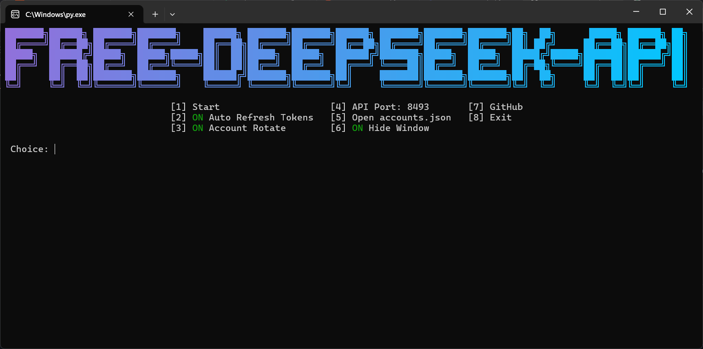

# Free-Deepseek-API




Self-hosted OpenAI-compatible API proxy for [chat.deepseek.com](https://chat.deepseek.com).
Runs a real browser session via **CloakBrowser** (stealth Chromium), so the site sees a genuine browser fingerprint and the WAF / PoW checks pass on their own — no captcha services, no manual solving.

> Built for use with [opencode](https://opencode.ai) and any other OpenAI-compatible client.

## Install

```bash
git clone https://github.com/lothiann/Free-Deepseek-API.git
cd Free-Deepseek-API
pip install -r requirements.txt
```

CloakBrowser ships its own Chromium, so there is no separate `playwright install` step.

## Get the token

chat.deepseek.com keeps the session in **`localStorage`**, not a cookie. Open https://chat.deepseek.com → DevTools (`F12`) → Console:

```js
copy(JSON.stringify({
  token:    JSON.parse(localStorage.userToken).value,
  user_id:  JSON.parse(localStorage['__appKit_userInfo'] || '{}').value?.id || '',
  web_id:   JSON.parse(localStorage['__tea_cache_tokens_20006317'] || '{}').web_id || '',
  device_id: localStorage['deepseek-device-id:chat'] || ''
}, null, 2))
```

Paste into `accounts.json`:

```json
{
  "rotate_every": 10,
  "accounts": [
    {
      "name": "main",
      "token": "64-char opaque userToken",
      "email": "optional - your login",
      "password": "optional - your password"
    }
  ]
}
```

| Field | Description |
|---|---|
| `token` | `userToken` from localStorage (**required**) |
| `user_id`, `web_id`, `device_id` | optional; filled in automatically if omitted |
| `email`, `password` | optional; enable automatic token refresh |
| `rotate_every` | requests per account before switching to the next one |

`accounts.json` holds secrets (email/password if set) — keep it out of git; the repo ships with an empty template. Accounts rotate round-robin.

## Models

| id | Behaviour |
|---|---|
| `deepseek-chat` | site's **Instant** mode, DeepThink off |
| `deepseek-reasoner` | DeepThink on — reasoning streamed via `delta.reasoning_content` |

## Run

```bash
python main.py
```

Interactive menu: `1` start, `2` toggle auto-refresh tokens, `3` toggle account rotation, `4` change API port, `5` open `accounts.json`, `6` toggle window hiding, `7` GitHub, `8` exit.

Server starts on `http://127.0.0.1:8493/v1`.

### Test

```bash
curl http://127.0.0.1:8493/v1/models

curl -N http://127.0.0.1:8493/v1/chat/completions \
  -H "Content-Type: application/json" \
  -d "{\"model\":\"deepseek-reasoner\",\"stream\":true,\"messages\":[{\"role\":\"user\",\"content\":\"say OK\"}]}"

# account status
curl http://127.0.0.1:8493/accounts
```

## opencode

Add to `~/.config/opencode/opencode.jsonc` (or `opencode.json`):

```jsonc
{
  "provider": {
    "deepseek": {
      "npm": "@ai-sdk/openai-compatible",
      "name": "DeepSeek (web proxy)",
      "options": {
        "baseURL": "http://127.0.0.1:8493/v1",
        "apiKey": "sk-nothing"
      },
      "models": {
        "deepseek-chat":     { "name": "DeepSeek Chat",     "limit": { "context": 2621440, "output": 2621440 } },
        "deepseek-reasoner": { "name": "DeepSeek Reasoner", "limit": { "context": 2621440, "output": 2621440 } }
      }
    }
  }
}
```

`apiKey` is ignored — the proxy binds to `127.0.0.1` and does not check it.

## Endpoints

| Endpoint | Description |
|---|---|
| `GET /v1/models` | model list |
| `POST /v1/chat/completions` | chat, streaming & non-streaming, with tools and images |
| `GET /accounts` | rotation status |
| `GET /debug/last` | last upstream response, for troubleshooting |

## Notes

- Tool calling works out of the box: send standard OpenAI `tools`, results come back as `role: "tool"` messages — nothing to configure.
- `image_url` parts (data URL or remote http) are supported.
- `usage` counts **characters**, matching the site's own input limit (2621440) — the `limit` values above account for that.
- Stale tokens: DeepSeek rotates `userToken` server-side and has no refresh endpoint. With `email`/`password` set, the proxy re-logs in and updates `accounts.json` automatically (menu option `2`).
- An account can be suspended by DeepSeek for "violation of user policies" — no proxy setting prevents that; rotation to another account is the only mitigation.
- Logs are written to `logs/`, the last raw response to `last_response.json`.

## Disclaimer

For personal / educational use. Automating chat.deepseek.com may violate its Terms of Service — use your own accounts at your own risk.
